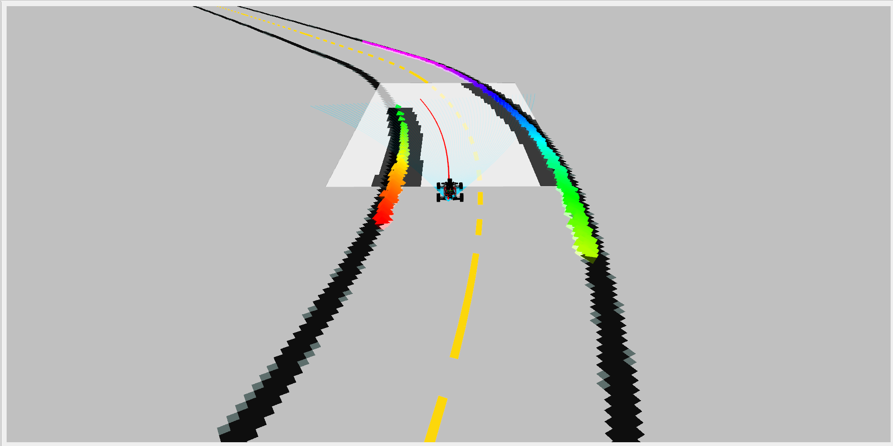
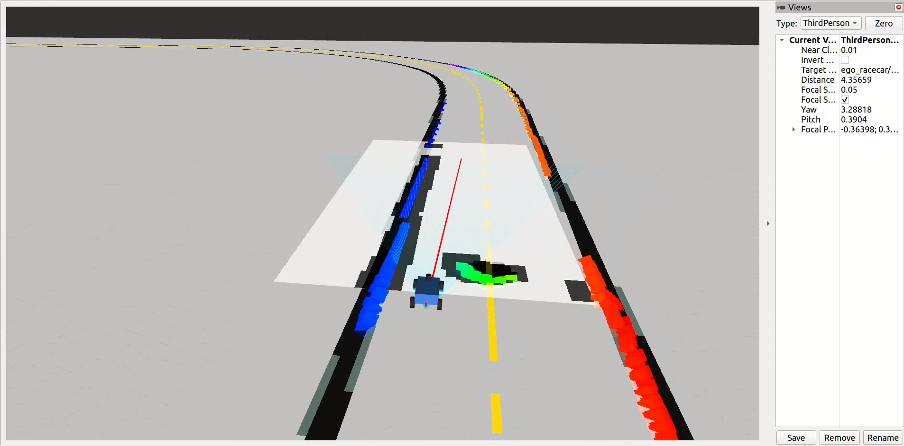
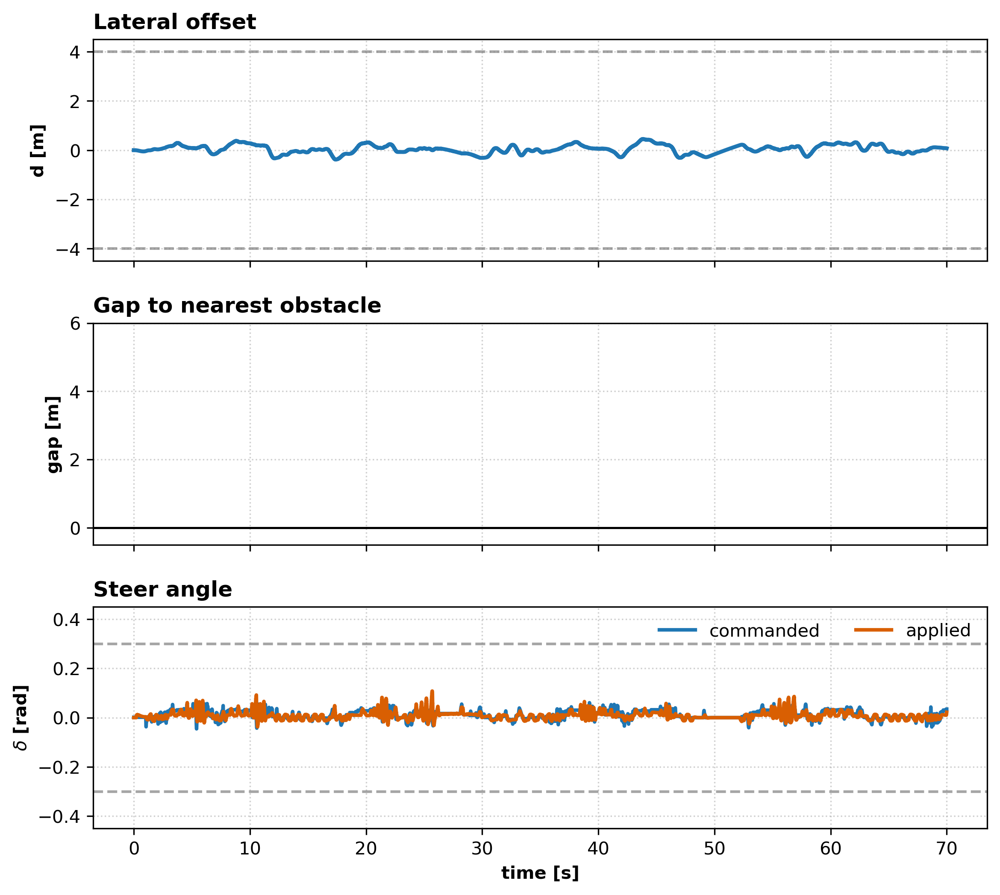
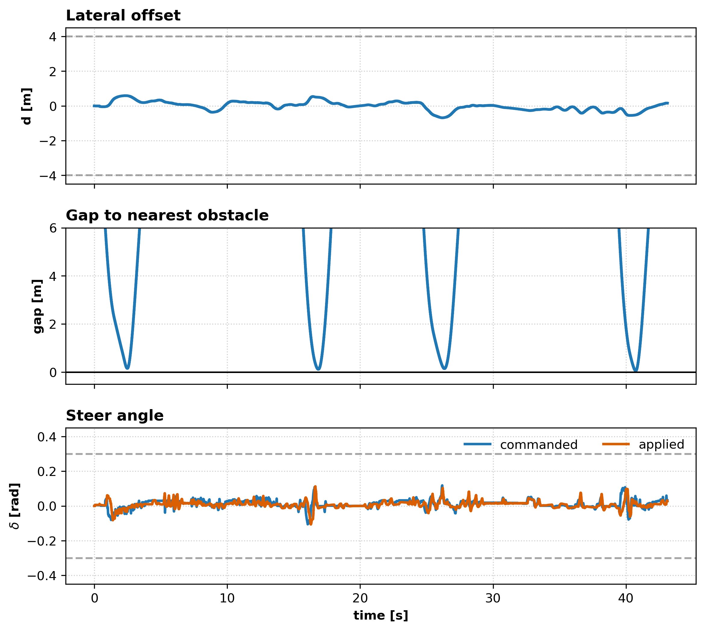
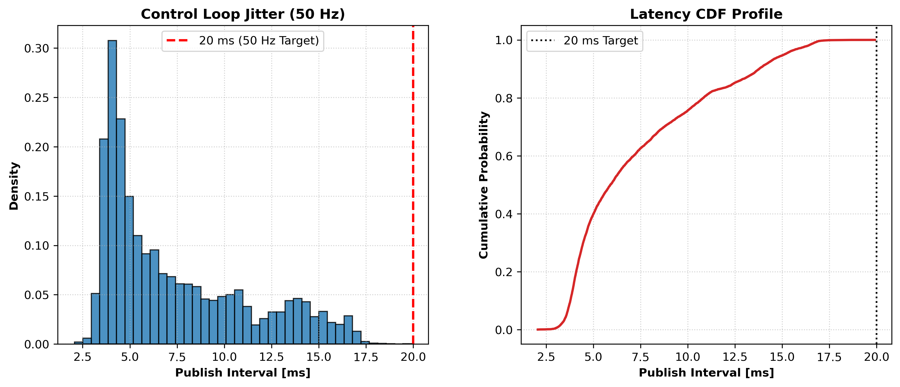
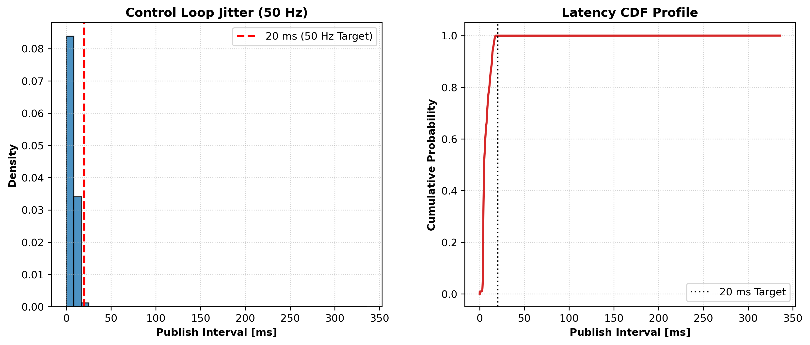

# Randomized MPC Controller for F1TENTH

## Overview

A ROS 2 package that runs a CUDA-accelerated Randomized Model Predictive Control (RMPC) controller in the F1TENTH simulator. The stack combines LiDAR-based obstacle avoidance with track-aware speed planning and configurable controller parameters.


## Demo 
[Youtube link](https://youtu.be/CLicTFfKjeo?si=9EVXIQpClDetIMqP)

## Features

- **GPU-accelerated RMPC:** Runs randomized model predictive control on CUDA.
- **Reactive obstacle avoidance:** Builds a local occupancy grid from LiDAR data and uses it to account for obstacles.
- **Track-aware planning:** Uses the IMS centerline and places benchmark obstacles on the track.
- **Velocity profiling:** Plans speed using cornering limits and a minimum forward speed near obstacles.
- **Configurable controller:** Exposes solver, vehicle, cost, and speed-limit parameters for tuning.
- **Offline evaluation:** Processes ROS 2 bags and saves benchmark plots in the package's `results/` directory.

Edit `config/config.yaml` to tune the controller parameters.

The `helper/randomized-mpc` submodule is a fork of the upstream project with the `-Werror` flag removed from `helper/randomized-mpc/CMakeLists.txt`.

## Prerequisites

- **OS:** Ubuntu 22.04 LTS (ROS 2 Humble)
- **GPU:** NVIDIA GPU with proprietary drivers installed
- **Docker:** Docker Engine & Docker Compose
- **NVIDIA Container Toolkit:** `nvidia-container-toolkit`


## Installation
For native setup, clone directly into the ROS workspace (no later move is needed). This location also works for the Docker workflow:

```bash
mkdir -p ~/rmpc_ws/src
cd ~/rmpc_ws/src
git clone --recurse-submodules https://github.com/IndraNeelMulakaloori/rmpc-simulation.git rmpc_f1tenth
cd rmpc_f1tenth/
```

## Docker-based workflow (recommended)

For RViz display, enable host X11 access:

```bash
xhost +local:root
```

Run the simulator and controller in separate terminals.

### Terminal 1: Simulator

Start the simulator container:

```bash
docker compose run --rm -w /sim_ws --name rmpc_f1tenth_container rmpc_stack
```

Inside the container, launch the simulator:

```bash
source .venv/bin/activate
source install/setup.bash
ros2 launch f1tenth_gym_ros gym_bridge_launch.py
```

### Terminal 2: RMPC controller + RViz

Attach to the running container:

```bash
docker exec -it -w /rmpc_ws rmpc_f1tenth_container bash
```

Launch the controller and RViz:

```bash
source install/setup.bash
ros2 launch rmpc_f1tenth rmpc_node.launch.py
```

## Native setup

Follow the [`f1tenth_gym_ros` Humble setup](https://github.com/f1tenth/f1tenth_gym_ros/tree/dev-humble). Paths below assume `~/sim_ws` and `~/rmpc_ws/src/rmpc_f1tenth`.

### Simulator

Create the venv, clone the simulator and Gym, install Gym, then build:

```bash
mkdir -p ~/sim_ws/src
python3 -m venv --system-site-packages ~/sim_ws/.venv
source ~/sim_ws/.venv/bin/activate
python3 -m pip install --upgrade pip

cd ~/sim_ws/src
git clone --branch dev-humble https://github.com/f1tenth/f1tenth_gym_ros.git
cd f1tenth_gym_ros
git clone --branch dev-humble https://github.com/f1tenth/f1tenth_gym.git
cd f1tenth_gym
python3 -m pip install -e .

cd ~/sim_ws
source /opt/ros/humble/setup.bash
rosdep update
rosdep install -i --from-path src --rosdistro humble -y
colcon build --symlink-install
```

If `f1tenth_gym` already exists, skip its clone. After building, copy the IMS assets and this package's simulator configuration into the installed simulator share directory:

```bash
source /opt/ros/humble/setup.bash
source ~/sim_ws/install/setup.bash
SIM_SHARE="$(ros2 pkg prefix f1tenth_gym_ros)/share/f1tenth_gym_ros"
mkdir -p "$SIM_SHARE/maps/IMS"
cp -a ~/rmpc_ws/src/rmpc_f1tenth/maps/IMS/. "$SIM_SHARE/maps/IMS/"
cp ~/rmpc_ws/src/rmpc_f1tenth/config/sim.yaml "$SIM_SHARE/config/sim.yaml"
```

### ROS package

After cloning this repository with its submodule, install dependencies and build from `~/rmpc_ws`:

```bash
cd ~/rmpc_ws
source /opt/ros/humble/setup.bash
rosdep update
rosdep install --from-paths src --ignore-src -r -y
colcon build --symlink-install --packages-select rmpc_f1tenth
```

Verify CUDA and CMake are installed. In each new controller terminal, source:

```bash
source /opt/ros/humble/setup.bash
source ~/rmpc_ws/install/setup.bash
```

### Choose the map

`config/sim.yaml` sets the ego start pose and selects the map; Docker mounts this file, while native setup copies it into the simulator share.

```yaml
map_path: 'maps/IMS/IMS_map'             # plain IMS map
# map_path: 'maps/IMS/IMS_map_obstacles' # IMS map with generated obstacles
```
For native runs, edit `~/sim_ws/src/f1tenth_gym_ros/config/sim.yaml` and rebuild; for Docker, edit `rmpc_f1tenth/config/sim.yaml`.

Only IMS is included; get additional tracks from [f1tenth_racetracks](https://github.com/f1tenth/f1tenth_racetracks) and install each map's YAML/image at the selected path.

### Generate obstacles (optional)

Edit `obstacle_coords` in `scripts/obstacle_creator.py` with map-frame `(x, y)` coordinates from RViz's **2D Pose Estimate** tool (`/initialpose`); the script requires `opencv-python`, `numpy`, `PyYAML`, and `pandas`.

```bash
cd ~/rmpc_ws/src/rmpc_f1tenth/scripts
python3 obstacle_creator.py
```

This creates `IMS_map_obstacles.png`; select `maps/IMS/IMS_map_obstacles` above and, for native runs, recopy the IMS directory to the simulator share.

### Run the stack

Start the simulator first.

**Terminal 1 : simulator**
```bash
cd ~/sim_ws
source .venv/bin/activate
source /opt/ros/humble/setup.bash
source install/setup.bash
ros2 launch f1tenth_gym_ros gym_bridge_launch.py
```

**Terminal 2 : controller and RViz**
```bash
source /opt/ros/humble/setup.bash
source ~/rmpc_ws/install/setup.bash
ros2 launch rmpc_f1tenth rmpc_node.launch.py
```

The nodes use `/ego_racecar/odom`, `/scan`, and `/drive`; use the same ROS domain in both terminals.

### RViz results




- **Yellow**: Centerline
- **Black** : Inflated obstacles
- **White**: Occupancy grid
- **Cyan**: Rollouts
- **Red**: Optimal trajectory
- **Green**: Detected obstacles

## Benchmarking & Performance Metrics

Two IMS-track ROS 2 bag runs were evaluated: clear-track baseline and obstacle slalom. Tests used ROS 2 Humble on an NVIDIA RTX 3090; `v_max` was set to 10.5 m/s (capped from 13.0 m/s for safety).

Values are from these two bag runs, not repeated-trial averages. The evaluator derives laps from centerline progress, estimates obstacle margin from three configured points, and measures intervals between `/drive` messages. Since each odometry callback solves before publishing, those intervals include the CUDA-backed solve and ROS/callback overhead; they are not GPU-only timings.

| Metric | Nominal Baseline (Clear Track) | Obstacle Slalom |
| :--- | :---: | :---: |
| **Detected laps** | 2 | 1 |
| **Fastest detected lap** | 32.62 s | 39.09 s |
| **Mean detected lap time** | 33.69 ± 1.07 s (2 laps) | 39.09 s (1 lap; spread unavailable) |
| **Analyzed odometry duration** | 70.74 s | 43.12 s |
| **Minimum estimated obstacle margin** | N/A | 0.054 m |
| **Configured rollout timestep (`solver.dt`)** | 20 ms (50Hz) | 20 ms (50Hz) |
| **Mean `/drive` message interval** | 7.37 ms | 7.03 ms |
| **Standard deviation of `/drive` intervals** | 3.80 ms | 5.72 ms |
| **P95 `/drive` interval** | 15.12 ms | 14.91 ms |
| **P99 `/drive` interval** | 16.69 ms | 16.79 ms |
| **Maximum `/drive` interval** | 19.91 ms | 335.87 ms (presumed startup transient*) |

Baseline clearance was not evaluated; the evaluator's 10,000 m value is a placeholder. The slalom's 0.054 m margin is a geometric estimate against three configured points, not a simulator collision result. `solver.dt` (20 ms) is the rollout step, not a measured control period or deadline. The 335.87 ms maximum is presumed to be startup delay, but this is unverified; the saved summary gives only the full-run P99, not the post-startup maximum.

### Trajectory results

| Nominal Baseline Tracking | Dynamic Obstacle Slalom |
| :---: | :---: |
|  |  |

### Drive-interval results
| Baseline Timing Profile | Active Slalom Timing Profile |
| :---: | :---: |
|  |  |

---


### Record a Telemetry Bag
The launch file below simultaneously runs the controller and records telemetry:
```bash
ros2 launch rmpc_f1tenth record.launch.py
```

In another terminal, Open **Rviz**
```bash
source install/setup.bash
rviz2 -d $(ros2 pkg prefix rmpc_f1tenth)/share/rmpc_f1tenth/rviz/map.rviz
```

Pass the recorded bag directory and reference centerline to `evaluation_suite.py`:


**For Nominal Baseline (No Obstacles):**
```bash
##  launch/record.laucnh.py saves the bag in ~/rmpc_f1tenth. 
##  Assuming the path hasn't changed

python3 src/rmpc_f1tenth/scripts/evaluation_suite.py \
  --bag_path ~/rmpc_f1tenth_telemetry/<your-recorded-bag> \
  --centerline src/rmpc_f1tenth/maps/IMS/IMS_centerline.csv \
  --window 70 \
  --filename baseline \
  --obstacles no
```

**For Obstacle Avoidance (With Obstacles):**
```bash
python3 src/rmpc_f1tenth/scripts/evaluation_suite.py \
  --bag_path ~/rmpc_f1tenth_telemetry/<your-recorded-bag> \
  --centerline src/rmpc_f1tenth/maps/IMS/IMS_centerline.csv \
  --window 70 \
  --filename bag \
  --obstacles yes
```
---


## Limitations and Future Work

- Supports the IMS map and centerline CSV format only; additional maps and `raceline.csv` support are planned.
- Obstacle-avoidance runs may become unstable after 3–4 runs; improving repeatability and stability needs further work.
- The current horizon and timestep are initial settings. Systematic tuning across horizons, timesteps, and other parameters remains future work.

## Takeaways

This project was a valuable opportunity to learn about vehicle dynamics, Pacejka tire models, 6-DoF modeling, and the inverse discrete cosine transform (IDCT). There is still more to understand for deeper insight into these methods. Special thanks to `Arun Muraleedharan` for the RMPC work that made this project possible.

## Contributing

Bug reports, feature ideas, and pull requests are welcome. For substantial changes, open an issue first; then fork the repository, create a focused branch, and submit a pull request describing the change and how it was tested. Build the ROS 2 package and, when possible, test it in the simulator before submitting.

## Acknowledgments & Citations

This project integrates the GPU-accelerated Randomized Model Predictive Control (RMPC) solver developed by **Arun Muraleedharan** with the **F1TENTH** autonomous racing simulation framework.

### Core Controller
The core controller in `helper/randomized-mpc` is governed by the [PolyForm Noncommercial License 1.0.0](helper/randomized-mpc/LICENSE.md) (Copyright © 2026 Arun Muraleedharan). If you use this package in your research, please cite the foundational RMPC papers:

- A. Muraleedharan, H. Okuda, and T. Suzuki, "Real-Time Implementation of Randomized Model Predictive Control for Autonomous Driving," *IEEE Transactions on Intelligent Vehicles*, vol. 7, no. 1, pp. 86–97, 2022. doi: [10.1109/TIV.2021.3062730](https://doi.org/10.1109/TIV.2021.3062730)
- A. Muraleedharan, I. Simões and G. Pau, "Randomized Model Predictive Control for Autonomous Racing," 2025 IEEE Intelligent Vehicles Symposium (IV), Cluj-Napoca, Romania, 2025, pp. 1078-1085, doi: [10.1109/IV64158.2025.11097631](https://doi.org/10.1109/IV64158.2025.11097631) 


### Simulation Platform
Simulation validation and testing utilise [f1tenth_gym_ros](https://github.com/f1tenth/f1tenth_gym_ros). If you use this platform, please cite the original F1TENTH simulator:

- M. O'Kelly, H. Zheng, D. Karthik, and R. Mangharam, "F1TENTH: An Open-source Evaluation Environment for Continuous Control and Reinforcement Learning," in *Proceedings of the NeurIPS 2019 Competition and Demonstration Track*, PMLR, 2020, pp. 77–89.

---

### BibTeX

```bibtex
@article{Muraleedharan_Real-Time_Implementation_of_2022,
author = {Muraleedharan, Arun and Okuda, Hiroyuki and Suzuki, Tatsuya},
doi = {10.1109/TIV.2021.3062730},
journal = {IEEE Transactions on Intelligent Vehicles},
number = {1},
pages = {11},
title = {{Real-Time Implementation of Randomized Model Predictive Control for Autonomous Driving}},
volume = {7},
year = {2022}
}

@inproceedings{okelly2020f1tenth,
  title={F1TENTH: An Open-source Evaluation Environment for Continuous Control and Reinforcement Learning},
  author={O’Kelly, Matthew and Zheng, Hongrui and Karthik, Dhruv and Mangharam, Rahul},
  booktitle={NeurIPS 2019 Competition and Demonstration Track},
  pages={77--89},
  year={2020},
  organization={PMLR}
}
```

## License

This project is licensed under [Apache License 2.0](LICENSE)
